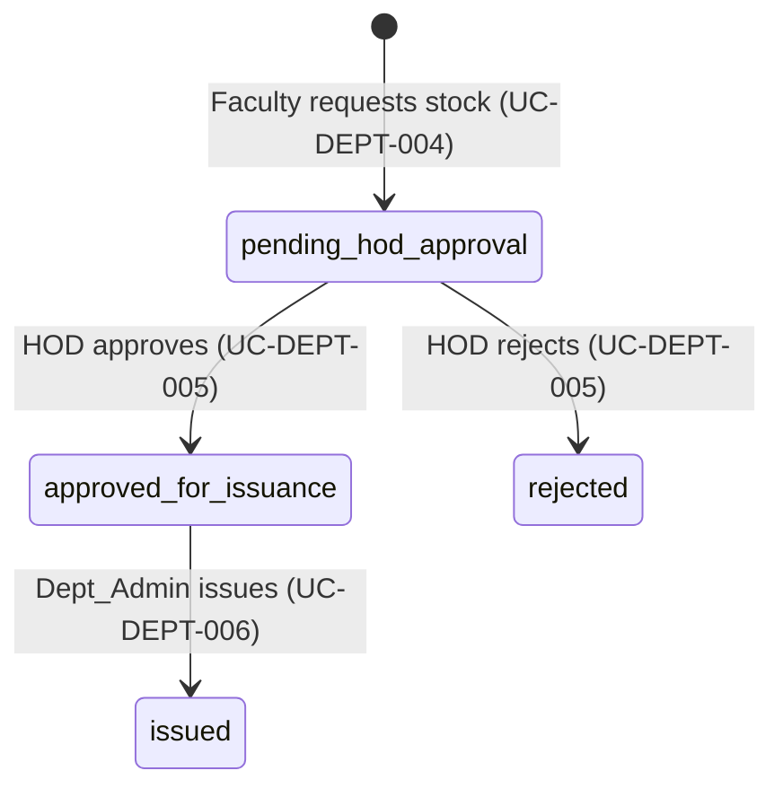
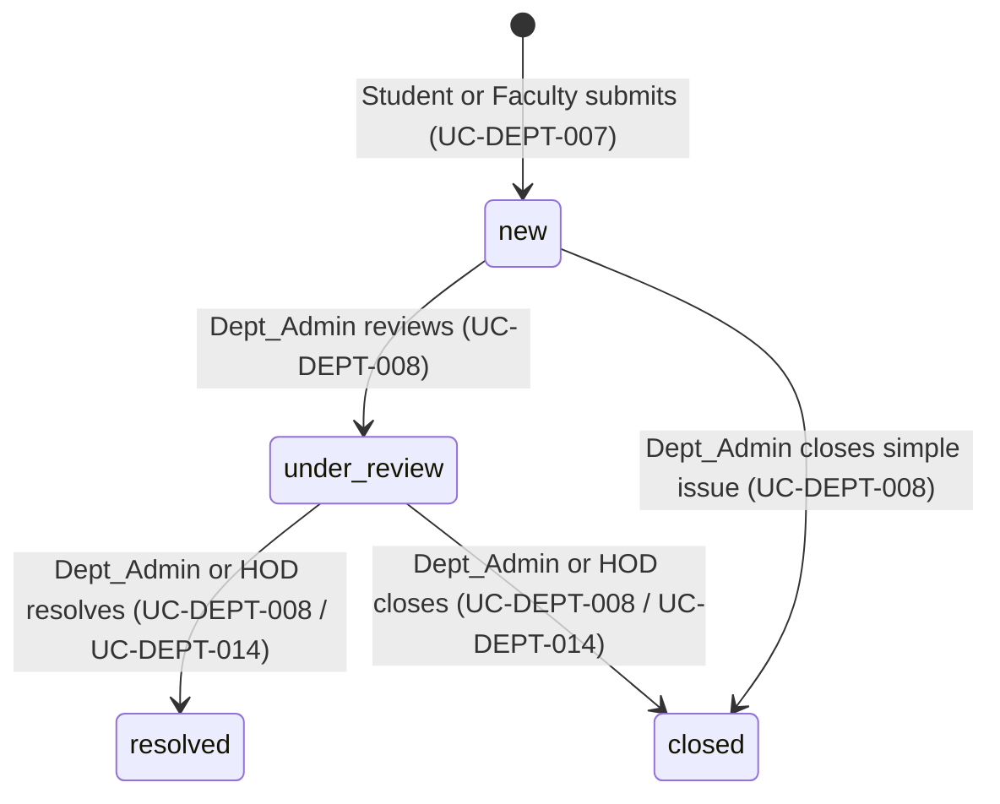
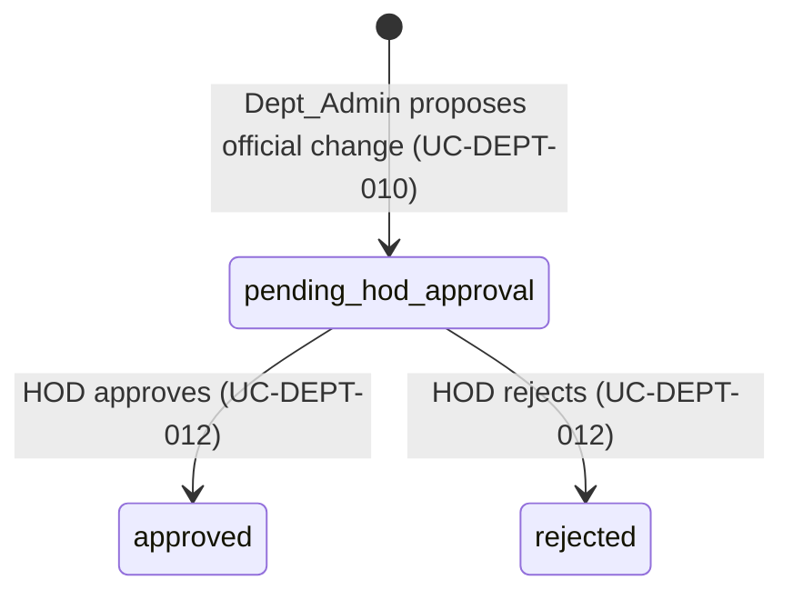
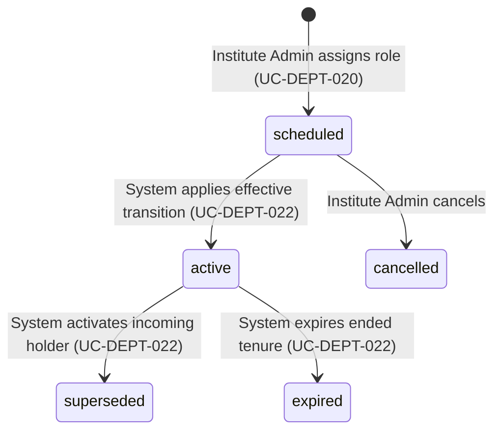

# Department Module — Domain Model and State Machines

## Bounded Context

The `department` module owns department-scoped administration inside `Fusion-Integrated`:

- **Announcements (`Announcement`)**: targeted by role, program, and academic year (`BR-DEPT-001`..`004`).
- **Inventory and Stock Requests (`InventoryItem`, `StockRequest`, `StockMovement`)**: append-only movement ledger (`BR-DEPT-016`), request-time availability validation (`BR-DEPT-015`), HOD approval (`BR-DEPT-006`), and Dept_Admin issuance with non-negative stock enforcement (`BR-DEPT-007`).
- **Confidential Feedback (`Feedback`, `FeedbackTransition`)**: confidential submission (`BR-DEPT-008`, `BR-DEPT-017`), mandatory Dept_Admin initial review (`BR-DEPT-018`), and Dept_Admin/HOD terminal disposition (`BR-DEPT-009`).
- **Timetables, Labs, and Academic Programs (`TimetableSlot`, `LabResource`, `DepartmentProgram`)**: conflict-free slot validation (`BR-DEPT-010`) and Faculty/Student views (`BR-DEPT-012`, `UC-DEPT-018`).
- **Department Profiles and Course Roster (`DepartmentProfile`, `CourseEnrollment`)**: role- and relationship-scoped profile projection (`BR-DEPT-019`) with `sensitive_personal_data` structurally excluded from all API serializers.
- **Department Details and Official Changes (`Department`, `OfficialDetailChange`)**: general details editable by Dept_Admin; official fields (`name`, `core_policies`) require HOD approval (`BR-DEPT-011`, `BR-DEPT-013`). Headship (`active_hod_user_id`) is derived from the active HOD role assignment (`AFR-DEPT-053`).
- **Time-Bound Role Governance (`DepartmentRoleAssignment`)**: time-bounded HOD and Dept_Admin tenures (`BR-DEPT-021`..`024`) with a partial unique constraint enforcing at most one active holder per `(department, role_type)`.

## State Machines

## Deployment Order

1. `python manage.py migrate`
2. `python manage.py seed_departments`
3. `python manage.py seed_modules`
4. `python manage.py permission_manifest` and seed IAM via `seed_iam_permissions --manifest <path>`
5. `python manage.py check_department_readiness`
